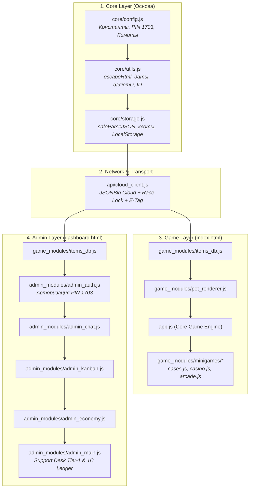

<div align="center">

# 🐾 Lex Labs: Kotya Pet & Mission Control

**Enterprise-Grade Cozy Virtual Pet Game & Real-Time LiveOps CRM Dashboard**

[](version.json)
[](version.json)
[](#-vanilla-js-layered-architecture)
[](#-zero-bundler-philosophy)
[](#)
[](dashboard.html)

<p align="center">
  <a href="#-quick-tour--feature-showcase">✨ Возможности</a> •
  <a href="#-vanilla-js-layered-architecture">🏛️ Архитектура</a> •
  <a href="#-dependency-flow--data-lifecycle">📐 Data Flow</a> •
  <a href="#-quickstart--local-development">🚀 Быстрый запуск</a> •
  <a href="#-security--data-integrity">🔒 Безопасность</a> •
  <a href="#-release--versioning-policy">🏷️ SemVer</a>
</p>

---

</div>

## 🌟 Обзор проекта (Elevator Pitch)

**Lex Labs: Kotya Pet & Mission Control** — это программный комплекс из двух тесно интегрированных подсистем, построенных на базе **чистого современного веб-стека (Vanilla JS Layered Architecture)** без тяжелых сборщиков (Webpack/Vite/Rollup):

1. **🐾 Игровой клиент (`index.html` + `app.js`)**: Уютный мобильный тамагочи с процедурной векторной отрисовкой питомца на Canvas/SVG, системой естественных потребностей (голод, энергия, радость, чистота), аркадными мини-играми, кейсами и живым чатом поддержки с отправкой скриншотов.
2. **🛡️ Lex Labs Mission Control (`dashboard.html` + `/admin_modules/`)**: Полноценная корпоративная панель управления в эстетике Linear и Vercel Dark. Включает 5-ветвевое дерево решений (Tier-1 CRM Support Decision Tree), бухгалтерский реестр 1C Ledger, Kanban дефектов разработки (Tier-2), балансировщик экономики (RTP) и автоматический AI-контроль реального бюджета (IRL Budget Guard).

---

## ✨ Возможности и функционал

### 🎮 Игровой мир (Game Client)
| Компонент | Описание | Модуль |
| :--- | :--- | :--- |
| **Анатомический Canvas/SVG** | 100% векторная динамическая отрисовка котика, эмоций, моргания и покачивания хвостика | `game_modules/pet_renderer.js` |
| **Гардероб и комнаты** | Десятки редких шапочек, очков, костюмов, окрасов шерстки и интерьеров комнат | `game_modules/items_db.js` |
| **Лутбоксы и кейсы** | Стандартные, премиальные и легендарные Black Box кейсы с честным RNG | `game_modules/minigames/cases.js` |
| **Казино и азартные игры** | Колесо фортуны, Слоты, Crash, Dice и скретч-карты с шансом на выигрыш реальных купонов | `game_modules/minigames/casino.js` |
| **Аркадные мини-игры** | Рыбалка, Бесконечный раннер (Subway Cat), Курьер еды, Rhythm Osu! | `game_modules/minigames/arcade.js` |
| **Хранилище желаний (Wishes)** | Персональные промокоды и купоны на реальные подарки с проверкой статуса | `core/storage.js` |

### 🎛️ Пульт управления (Mission Control & CRM)
| Компонент | Описание | Модуль |
| :--- | :--- | :--- |
| **Авторизация оператора** | PIN-авторизация (`1703`), разделение операторов и сессии в `sessionStorage` | `admin_modules/admin_auth.js` |
| **Tier-1 Support Decision Tree** | 5-ветвевой мастер быстрого разрешения инцидентов (Финансы, Дропы, Питомец, Купоны, Тех. сбои) | `admin_modules/admin_main.js` |
| **Live Support Chat** | Оперативный мессенджер с игроком, дедупликация, вложения и полноэкранный Lightbox | `admin_modules/admin_chat.js` |
| **Tier-2 Bug Tracker Kanban** | Доска дефектов (Входящие, В работе, Тест, Готово), секундомер задач и генератор AI-промптов | `admin_modules/admin_kanban.js` |
| **1С Ledger & Аудит** | Хронологический реестр транзакций, расчет сальдо и двойная запись компенсаций | `admin_modules/admin_main.js` |
| **AI Macro-Economy Advisor** | Мониторинг RTP игр, автоматическая балансировка шансов и лимит 5 000 ₽ на подарки | `admin_modules/admin_economy.js` |

---

## 🏛️ Vanilla JS Layered Architecture

В архитектуре проекта реализован принцип **чистых слоев с нисходящей иерархией зависимостей**. Ни один модуль нижнего слоя не зависит от верхнего:

```
TestKate/ (v2.4.1)
│
├── 🌐 index.html                         # Точка входа: Мобильный игровой клиент
├── ⚙️ app.js                             # Ядро движка Тамагочи, звуки (Web Audio), таймеры
│
├── 🧱 core/                              # Базовый слой ядра (Zero Dependencies)
│   ├── config.js                         # Константы, PIN оператора (1703), JSONBin ключи, лимиты
│   ├── storage.js                        # readStorage, writeStorage, safeParseJSON, обработка квот
│   └── utils.js                          # Канонический escapeHtml, форматирование дат, сумм, ID
│
├── 🛰️ api/                               # Сетевой транспорт и синхронизация
│   └── cloud_client.js                   # JSONBin REST API, Race Condition Lock, E-Tag, кэш
│
├── 🎮 game_modules/                      # Игровая предметная область (Game Domain)
│   ├── items_db.js                       # База предметов, редкостей и визуальных параметров
│   ├── pet_renderer.js                   # SVG/Canvas-рендерер питомца, комнат и слоев
│   └── minigames/                        # Подсистема мини-игр
│       ├── cases.js                      # Генераторы дропа лутбоксов
│       ├── casino.js                     # Азартные механики: слоты, краш, кости, скретч
│       └── arcade.js                     # Аркадный движок: раннер, ритм-игра, рыбалка
│
├── 🛡️ dashboard.html                     # Точка входа: Lex Labs Mission Control
├── 💼 admin_modules/                     # Слой бэк-офиса и управления (Admin Domain)
│   ├── admin_auth.js                     # PIN-авторизация (1703) и сессии оператора
│   ├── admin_chat.js                     # Мессенджер оператора с игроком, превью и Lightbox
│   ├── admin_kanban.js                   # Канбан дефектов (Tier-2), таймеры, логи ошибок
│   ├── admin_economy.js                  # Балансировщик RTP, лимит 5000 ₽ IRL, шансы
│   └── admin_main.js                     # Контроллер дашборда, 1C Ledger, Support Desk Tier-1
│
├── 📄 version.json                       # Единый источник правды версионирования (SSOT)
├── 📦 package.json                       # Конфигурация проекта и npm-скрипты проверки
├── 📝 CHANGELOG.md                       # История версий (Keep a Changelog)
└── 📘 README.md                          # Главный файл проектной документации
```

---

## 📐 Dependency Flow & Data Lifecycle



---

## 🔒 Security & Data Integrity

* 🛡️ **Единый XSS-санитайзер**: Устранена рекурсия и множественные дубликаты. Функция `escapeHtml` строго определена в одном месте (`core/utils.js`) и предотвращает внедрение зловредного HTML/JS при рендеринге пользовательских сообщений и логов.
* ⚡ **Защита от состояния гонки (Race Condition Lock)**: Сетевой модуль `api/cloud_client.js` снабжен атомарным флагом сохранения `isCloudSaving` и буфером `pendingCloudPayload`, что исключает затирание прогресса при частых кликах.
* 📦 **Защита от переполнения квоты (`QuotaExceededError`)**: Модуль `core/storage.js` перехватывает сбои браузерного хранилища и автоматически очищает второстепенные кэши, сохраняя критический прогресс игрока.
* 💾 **Offline-First & Auto-Fallback**: При отсутствии интернета или сбое облака JSONBin система автоматически переключается на локальный кэш браузера, не прерывая игровой процесс.

---

## 🚀 Quickstart & Local Development

### 1. Запуск локального сервера
Для работы игры и панели управления необходим любой веб-сервер. Запуск стандартным встроенным сервером Python:

```powershell
python -m http.server 8080
```

### 2. Ссылки в браузере:
* 🐾 **Клиент игры**: [http://localhost:8080/index.html](http://localhost:8080/index.html)
* 🎛️ **Mission Control**: [http://localhost:8080/dashboard.html](http://localhost:8080/dashboard.html)  
  *Операторский доступ:* `alex` / PIN: **`1703`**

### 3. Статическая валидация синтаксиса
Проверка чистоты JavaScript-кода всех модулей проекта без сборщиков:

```powershell
node --check app.js core/*.js api/*.js game_modules/*.js game_modules/minigames/*.js admin_modules/*.js
```

Или через alias:
```powershell
npm run check
```

---

## 🏷️ Release & Versioning Policy

Проект строго следует спецификации **[Semantic Versioning 2.0.0](https://semver.org/)** и соглашению **[Conventional Commits](https://www.conventionalcommits.org/)**:

* **MAJOR (`X.0.0`)**: Мажорные архитектурные изменения (например, переход на модульную слоистую архитектуру).
* **MINOR (`0.X.0`)**: Добавление новых игровых механик, мини-игр или возможностей в Mission Control.
* **PATCH (`0.0.X`)**: Исправление багов, оптимизация рендеринга и мелкие полировки интерфейса.

Единым источником правды для версии является файл [`version.json`](file:///c:/Users/Погонаж/Desktop/Новая папка (3)/version.json), значения из которого синхронизируются в `package.json`, `index.html` и `dashboard.html`.

---

<div align="center">

**Спроектировано и реализовано с любовью 💖**  
*Lead Architect & Developer: Alex (Lex Labs)*  
© 2026 Lex Labs Enterprise. Все права защищены.

</div>
